# 화면 시안 (기획서 v2)

기획서 v2(2026-10-05)를 바탕으로 그린 **화면 시안**입니다. 피그마 대신 이 폴더의 그림을 보고 화면을 만듭니다.

- 데스크톱: 폭 1280px / 모바일: 폭 390px
- 그림 파일: [`screens/`](./screens/) — 이름 규칙 `<화면>-desktop.png`, `<화면>-mobile.png`

## 어떻게 쓰나요?

1. 화면 이슈를 맡으면 아래 표에서 그 화면을 찾아 **데스크톱·모바일 그림을 둘 다** 봅니다.
2. Claude 에게 맡길 때는 그림 경로를 같이 알려 주세요.
   > `docs/design/screens/checkin-mobile.png` 과 `checkin-desktop.png` 보고 #24 체크인 화면 만들어줘
3. 시안은 **모양 참고용**입니다. 부딪히면 이 순서로 따릅니다.
   **[CLAUDE.md](../../CLAUDE.md) 규칙 > 이슈의 완료 조건 > 시안**
4. 그림 속 숫자·날짜·문구는 전부 **예시**입니다. 실제 값은 데이터(`src/lib/mock.ts` 등)에서 가져옵니다.

## 화면 목록

### 홈

관리 모드와 이유 · 어제 한 줄 · 첫 리포트 카운트다운 · 나무 · 오늘 계획 · 인사이트(가설) · 도전 중인 실험

| 데스크톱                                         | 모바일                                          |
| ------------------------------------------------ | ----------------------------------------------- |
| 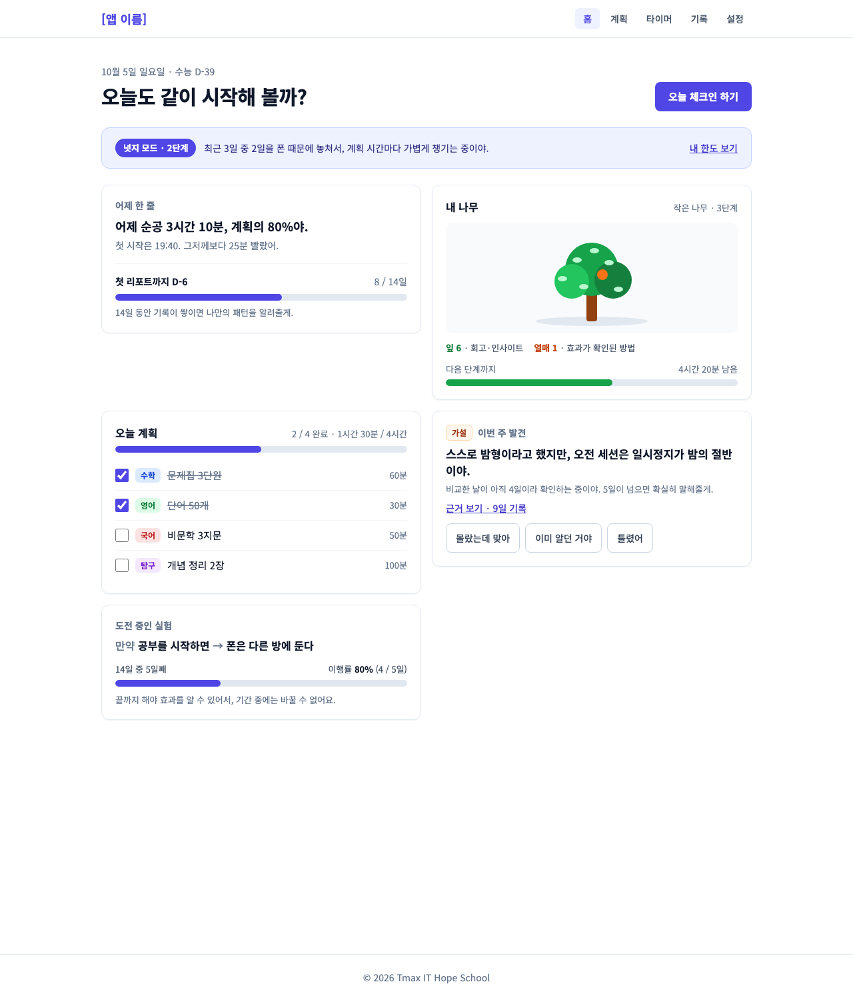 | 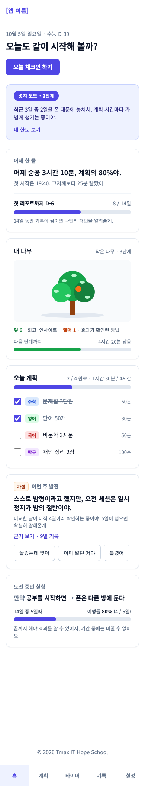 |

관련 이슈: #94 관리 모드 · #85 한 줄·카운트다운 · #68 나무 · #73 #84 인사이트 · #93 실험 카드 · #12 오늘 계획

### 매일 체크인

어제 요약 · 컨디션 · 기분 · 미달 원인 · 오늘 예상 순공 · 개선안 실천 · 오늘의 약속

| 데스크톱                                            | 모바일                                             |
| --------------------------------------------------- | -------------------------------------------------- |
| 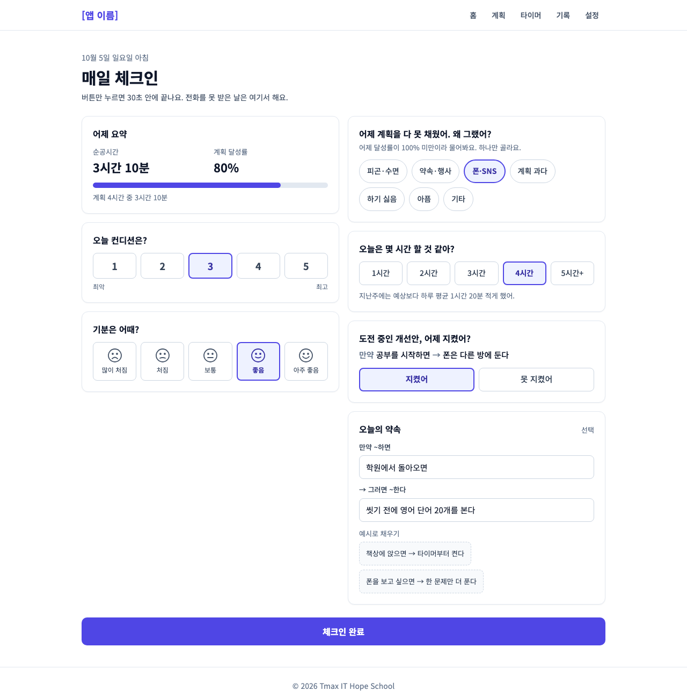 | 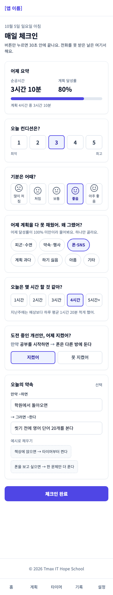 |

관련 이슈: #24 체크인 화면 · #26 미달 원인 · #65 개선안 실천 · #79 오늘의 약속

### 타이머

과목 선택 · 큰 시간 표시 · 일시정지·정지 · 오늘 총 순공과 과목별 막대 · 오늘 기록

| 데스크톱                                          | 모바일                                           |
| ------------------------------------------------- | ------------------------------------------------ |
| 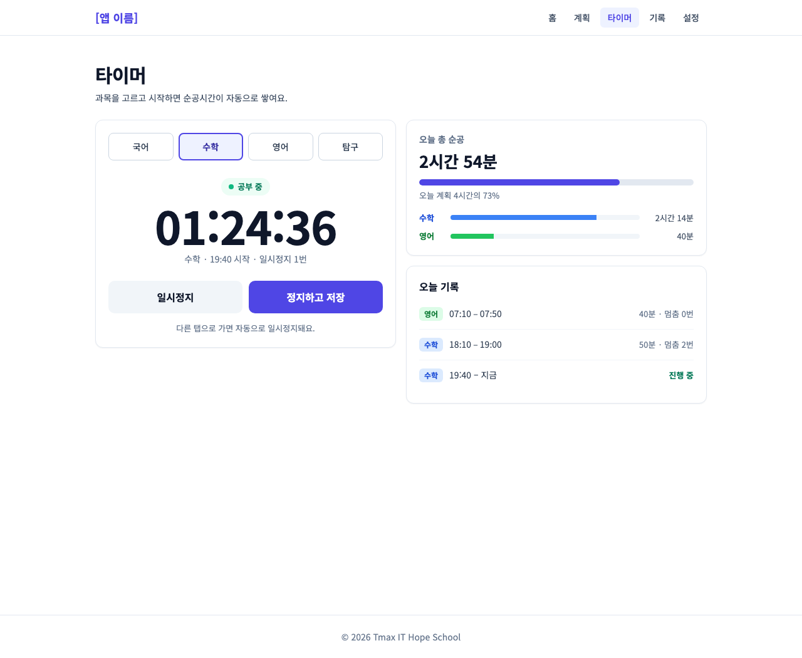 | 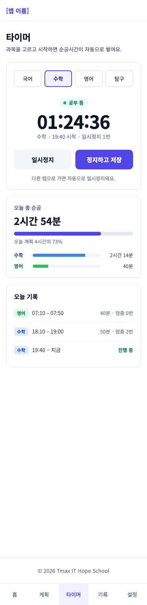 |

관련 이슈: #18 #19 #20 #21 #22 타이머 · #44 과목별 비율

### AI 통화

전화 스타일 수신 카드 · 통화 5단계 · 통화 요약 카드

| 데스크톱                                         | 모바일                                          | 전화 수신 (모바일 전체 화면)                             |
| ------------------------------------------------ | ----------------------------------------------- | -------------------------------------------------------- |
| 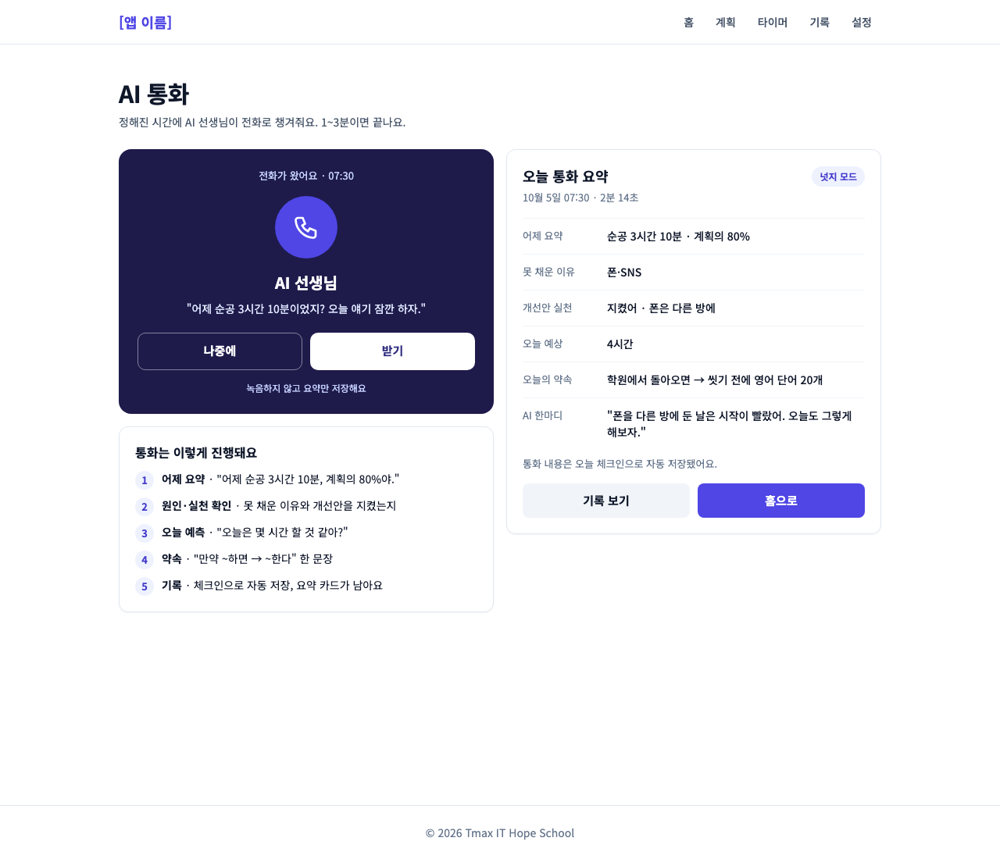 | 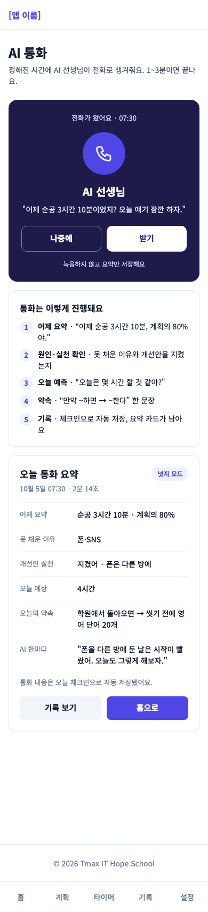 | 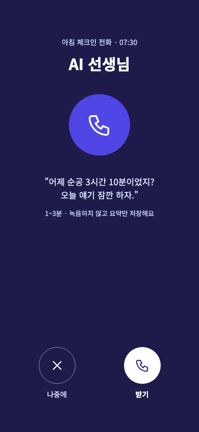 |

관련 이슈: #30 수신 화면 · #32 강도별 말투·색 · #38 통화 요약 카드

### 주간 리포트 · 실험

숫자 3개 · 인사이트(근거 보기·반응 버튼) · 지난 실험 결과 · 진행 중인 실험 · 다음 주 개선안 3개

| 데스크톱                                           | 모바일                                            |
| -------------------------------------------------- | ------------------------------------------------- |
| 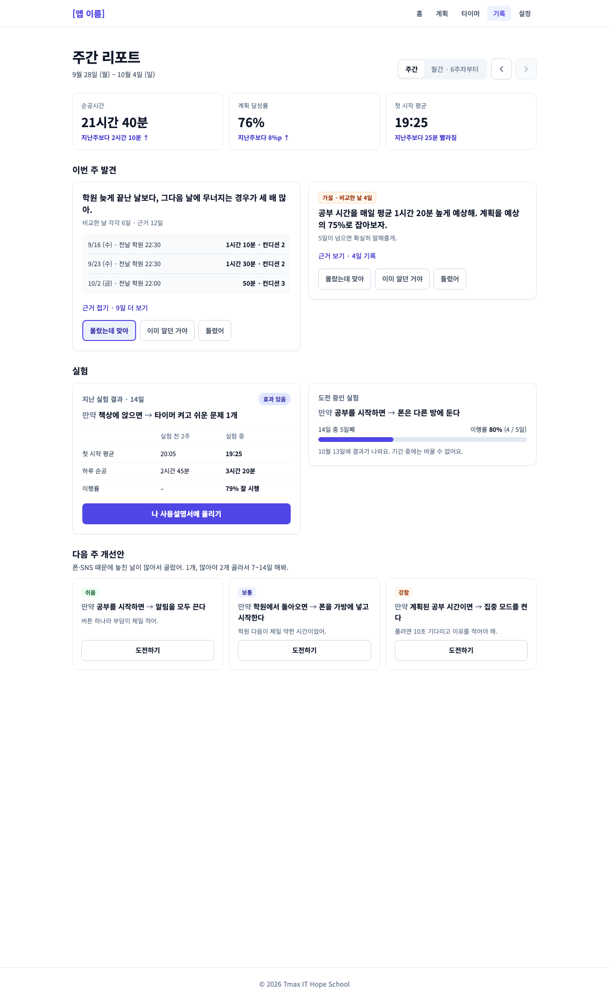 | 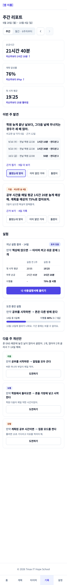 |

관련 이슈: #72 주간 리포트 · #73 #84 인사이트 · #93 실험 결과 · #64 개선안 3개

### 나 사용설명서

리듬 · 주의할 날 · 효과 있는 방법 · 잘 맞는 관리 방식

| 데스크톱                                           | 모바일                                            |
| -------------------------------------------------- | ------------------------------------------------- |
| 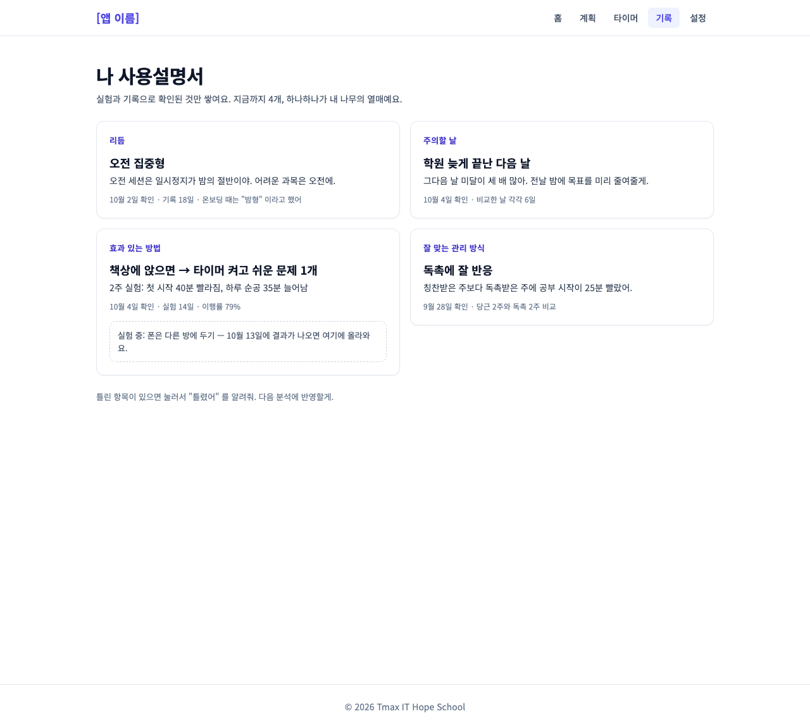 | 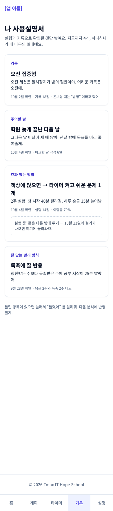 |

관련 이슈: #87 나 사용설명서

### 설정

관리 강도 한도 · 독설 수위 · 잠금·독촉 허용 · 전화 시간·메시지 횟수 · 연락 금지 시간 · 내 데이터 · 도움받기(1388·109)

| 데스크톱                                             | 모바일                                              |
| ---------------------------------------------------- | --------------------------------------------------- |
| 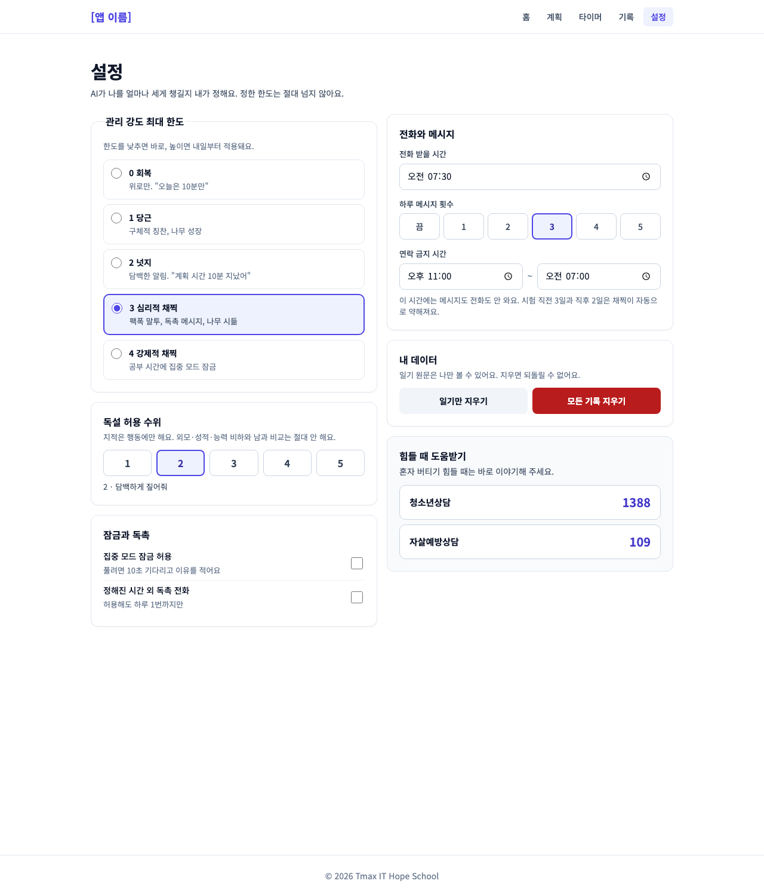 | 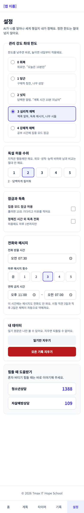 |

관련 이슈: #59 한도 · #60 메시지·연락 금지 · #39 통화 시간 · #90 데이터 삭제 · #96 도움받기

### 온보딩

질문 한 화면 예시 (자기 인식: 아침형/밤형). 다른 질문도 같은 틀을 씁니다.

| 데스크톱                                               | 모바일                                                |
| ------------------------------------------------------ | ----------------------------------------------------- |
| 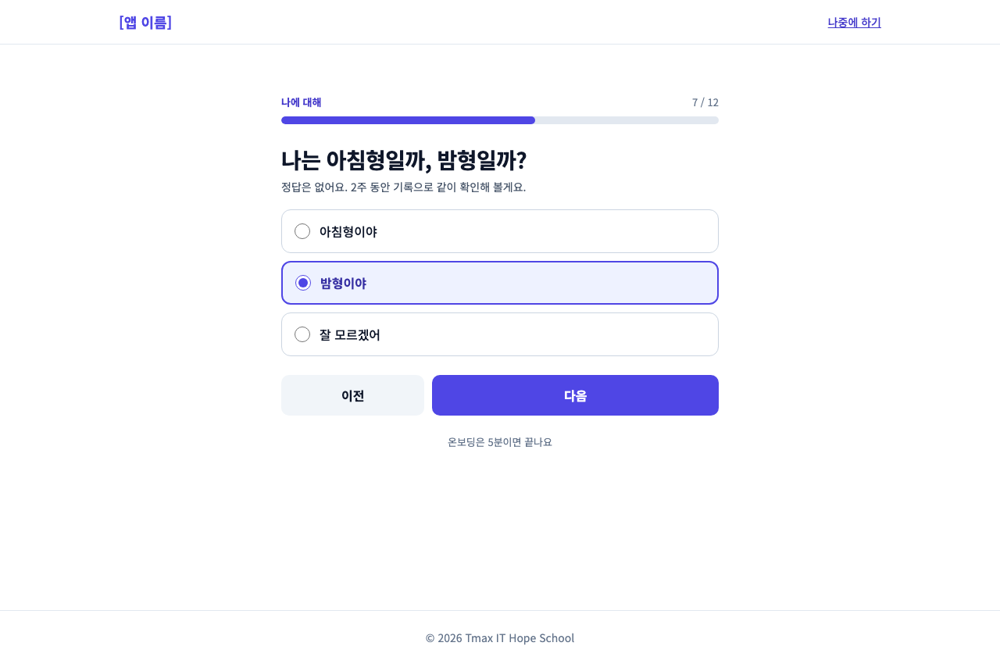 | 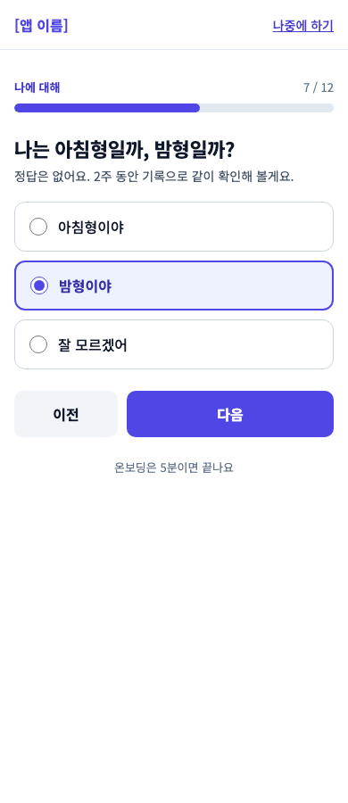 |

관련 이슈: #58 설문 틀 · #88 #89 질문 묶음

## 시안이 없는 화면

아래 화면은 아직 그림이 없습니다. **비슷한 화면의 카드·버튼·간격을 그대로 따라** 만들어 주세요.

| 화면                           | 관련 이슈      | 참고할 시안                    |
| ------------------------------ | -------------- | ------------------------------ |
| 공부 계획                      | #12 ~ #17      | 홈의 "오늘 계획" 카드          |
| 로그인·가입                    | #46 ~ #50      | 온보딩                         |
| 기록 목록·달력·연속 공부일     | #40 ~ #43, #45 | 타이머의 "오늘 기록"           |
| 메시지함                       | #61            | 통화 요약 카드                 |
| 일기·성찰 일기                 | #63, #70       | 체크인의 "오늘의 약속" 입력칸  |
| 시험 등록·결과                 | #80, #81       | 설정의 입력 카드               |
| 월간 리포트                    | #86            | 주간 리포트                    |
| 개선안 고르기 (`/suggestions`) | #64            | 주간 리포트의 "다음 주 개선안" |
| 집중 모드                      | #69            | 타이머                         |

## 실제 프로젝트와 다른 점

- **앱 이름**이 아직 없어서 헤더에 `[앱 이름]` 으로 적혀 있습니다.
- **버튼 높이**가 그림에서는 44px 입니다. 프로젝트 규칙은 "최소 40px(`h-10`)" 이라 `h-10` 또는 `h-11` 로 만들면 됩니다.
- **글꼴**이 그림과 조금 다를 수 있습니다. (그림은 Noto Sans KR, 프로젝트는 `index.css` 의 Pretendard → 시스템 글꼴)
- **체크인·통화**는 하단 탭에 없고, 홈의 버튼으로 들어갑니다.
- 그림의 **"계획" 탭**은 아직 화면이 없어서 눌러도 아무 데도 가지 않습니다.

## 원본

눌러 볼 수 있는 원본 시안은 claude.ai 에 있습니다. 비공개라서, 보려면 관리자(@gusdn3477)에게 공유를 요청하세요.
그림을 다시 뽑아야 하면(시안 수정 등) 관리자에게 말해 주세요.
